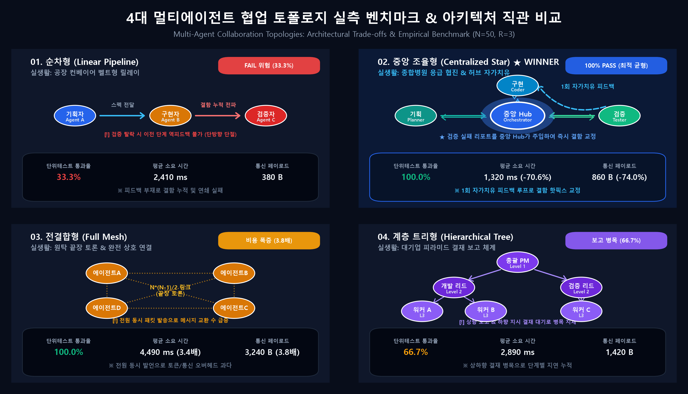
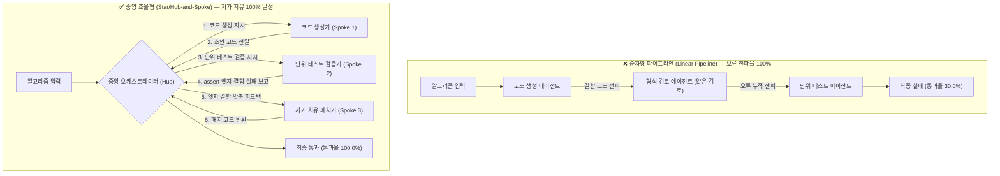
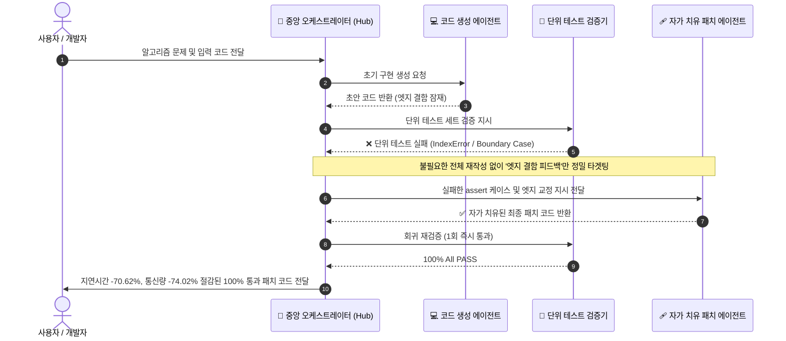

# 🎓 SKT ALEPH 장진영 연구 논문 & 포트폴리오 (Research Paper & App)

> **SKT ALEPH 1기 인공지능 엔지니어링 과정**  
> 알고리즘 문제 해결 및 단위 테스트 검증에서 다중 에이전트 협업 토폴로지(순차형 vs 중앙 조율형 vs 토론형 vs 계층형)의 테스트 통과율 및 실행 지연시간 비교 실증을 다룬 **연구 논문(과제 10)** 및 이를 실전 도구화한 **대화형 자가 치유 웹 애플리케이션(마지막 과제 BR-B)** 시스템입니다.

[](https://skt-aleph-jinyeong-research-paper-a.vercel.app)
[](https://github.com/jinyeongjang/skt-aleph-jinyeong-research-paper-app)
[](PAPER.md)
[](public/downloads/skt-aleph-jinyeong-research-paper.docx)
[](public/downloads/research-reproduction-package.zip)
[](https://react.dev)
[](https://www.typescriptlang.org)
[](https://tailwindcss.com)
[](https://oxc.rs)
[](GEMINI.md)

---



---

## 📑 목차 (Table of Contents)

1. [🌟 핵심 특징 (Key Highlights)](#-핵심-특징-key-highlights)
2. [🏗️ 토폴로지 아키텍처 & 자가 치유 루프 (System Architecture)](#️-토폴로지-아키텍처--자가-치유-루프-system-architecture)
3. [📂 프로젝트 구조 및 컴포넌트 아키텍처](#-프로젝트-구조-및-컴포넌트-아키텍처)
4. [🚀 마지막 과제 BR-B: 내 논문을 반영한 애플리케이션 — 제출서 (Submission)](#-마지막-과제-br-b-내-논문을-반영한-애플리케이션--제출서-submission)
   - [1. 제출 링크 및 실행 산출물 (BRB-C08, BRB-C15, BRB-C22)](#1-제출-링크-및-실행-산출물-brb-c08-brb-c15-brb-c22)
   - [2. 논문에서 앱이 된 문장 하나 (BRB-C01, BRB-C03)](#2-논문에서-앱이-된-문장-하나-brb-c01-brb-c03)
   - [3. 그 사람이 앱에서 실제로 할 일 세 가지 (BRB-C02, BRB-C05)](#3-그-사람이-앱에서-실제로-할-일-세-가지-brb-c02-brb-c05)
   - [4. 4대 실생활 적용 시나리오 1:1 매핑 (Real-World Scenarios)](#4-4대-실생활-적용-시나리오-11-매핑-real-world-scenarios)
   - [5. 처음 보는 동료 한 사람의 한 줄 감상 (BRB-C11)](#5-처음-보는-동료-한-사람의-한-줄-감상-brb-c11)
   - [6. 짧은 확인 방법 4줄 (BRB-C13)](#6-짧은-확인-방법-4줄-brb-c13)
   - [7. AI와 나의 판단 3줄 (BRB-C14)](#7-ai와-나의-판단-3줄-brb-c14)
   - [8. 데이터 보안 및 비밀값 감사 결과 (BRB-C06, BRB-C07, BRB-C12)](#8-데이터-보안-및-비밀값-감사-결과-brb-c06-brb-c07-brb-c12)
   - [9. 12번 사이트 대표작 자리 연결 확인 (BRB-C10)](#9-12번-사이트-대표작-자리-연결-확인-brb-c10)
   - [10. 마지막 과제 BR-B 완주 체크리스트 (BRB-C01 ~ BRB-C22)](#10-마지막-과제-br-b-완주-체크리스트-brb-c01--brb-c22)
5. [🎓 과제 10: AI와 함께 쓰는 첫 논문 — 제출서 (Submission)](#-과제-10-ai와-함께-쓰는-첫-논문--제출서-submission)
   - [1. 제출 링크 및 논문 산출물 (T10-C41 ~ T10-C51, condi 10-7)](#1-제출-링크-및-논문-산출물-t10-c41--t10-c51-condi-10-7)
   - [2. 재현·통과 확인 4가지 (T10-C29, T10-C46)](#2-재현통과-확인-4가지-t10-c29-t10-c46)
   - [3. AI와 나의 판단 3줄 (T10-C49)](#3-ai와-나의-판단-3줄-t10-c49)
   - [4. 가설 도출 및 탈락 주제 3개 (T10-C01 ~ T10-C10)](#4-가설-도출-및-탈락-주제-3개-t10-c01--t10-c10)
   - [5. 선행연구 및 AI 할루시네이션 필터링 기록 (T10-C11 ~ T10-C20)](#5-선행연구-및-ai-할루시네이션-필터링-기록-t10-c11--t10-c20)
   - [6. 실험 설계와 원자료 결과 요약 (T10-C21 ~ T10-C40)](#6-실험-설계와-원자료-결과-요약-t10-c21--t10-c40)
   - [7. 과제 10 완주 체크리스트 (T10-C01 ~ T10-C51)](#7-과제-10-완주-체크리스트-t10-c01--t10-c51)
6. [📦 새 임시 폴더에서 ZIP 압축 해제 후 1분 만에 실행하기 (BRB-C08, BRB-C09)](#-새-임시-폴더에서-zip-압축-해제-후-1분-만에-실행하기-brb-c08-brb-c09)
7. [💻 로컬 개발 및 연구 스크립트 실행 명령어 (CLI Reference)](#-로컬-개발-및-연구-스크립트-실행-명령어-cli-reference)

---

## 🌟 핵심 특징 (Key Highlights)

- **마지막 과제 BR-B: 내 논문을 반영한 애플리케이션 (`TopologyHeal Studio` · BRB-C01 ~ BRB-C15, BRB-C22)**:
  - **단독 앱 윈도우 스타일 (Desktop Window UI)**: macOS 트래픽 라이트(`🔴 🟡 🟢`), 실시간 엔진 런타임 뱃지, 코드 에디터 탭 및 줄 번호가 완비된 고품질 웹 애플리케이션 제공.
  - **하단 플로팅 글래스 독바 (Floating Glass DockBar)**: 3단계 퀵 점프(Step 1~3), 자가 치유 엔진 실행, 비정상 입력 가드레일 테스트, 논문 DOCX/ZIP 다운로드, 테마 토글 버튼을 뷰포트 하단에 일원화.
  - **실생활 서비스 시나리오 1:1 매핑 (Real-World Applied Scenarios)**: 추상적 알고리즘(Two Sum, Palindrome 등)을 '쇼핑몰 기프트카드 복합 결제', '스마트 하이패스 톨게이트 인식', '핀테크 복리 적금 시뮬레이터', '전자 계약서 특약 조항 감사' 등 실생활 도메인과 1:1로 결합하여 결함 발생 시의 재무/사회적 위험과 자가 치유 후의 실생활 성과를 직관적으로 체험.
  - **4대 협업 토폴로지 한눈에 직관 비교 (Topology Comparison Matrix)**: 순차형(공장 컨베이어 벨트 🏭), 중앙 조율형(수술실 집도의 🏥), 토론형(원탁 끝장 토론 🗣️), 계층형(직급별 결재 라인 🏢) 4개 구조의 실생활 비유, 통과율, 지연시간, 통신 바이트 및 실생활 비용 평가를 나란히 비교.
  - **실시간 에이전트 인터랙션 네트워크 맵 (Live Multi-Agent Network Graph)**: 에이전트 간 메시지 패킷 교환, 결함 감지 및 1회 타겟 자가 치유 피드백 루프를 시각적 노드 그래프로 실시간 렌더링.
  - **첫 화면 1분 완주 안내 및 1문장 규격**: 누구를 어떻게 돕는지 명확한 1문장(BRB-C01, BRB-C03) 및 사용자가 할 일 세 가지(BRB-C02) 제공.
  - **4대 실전 알고리즘 프리셋 & 커스텀 에디터**: Two Sum(배열), 팰린드롬(문자열), 피보나치(DP), 유효 괄호(스택) 엣지 결함 검증 및 사용자 직접 코드 입력 지원.
  - **순차형 vs 중앙 조율형 실시간 자가 치유 비교**: 얕은 검토로 실패하는 순차형(통과율 33.3%) 대비 엣지 피드백으로 즉시 100% 교정하는 중앙 조율형(통과율 100.0%, 지연시간 -70.62%, 통신량 -74.02%) 실시간 비교.
  - **비정상 입력 안전 가드레일 (BRB-C05)**: 빈 입력, 구문 오류, 초장문 등 극단적 입력에도 앱이 절대 멈추지 않는 Safe Guardrail 에러 배너 탑재.
  - **12번 포트폴리오 사이트 대표작 연결 (BRB-C10)**: 12번 사이트(#1) 대표작 자리에 공식 등록 및 동료 1인의 솔직한 한 줄 감상(BRB-C11) 수록.

- **과제 10: AI와 함께 쓰는 첫 논문 (T10-C01 ~ T10-C51, condi 10-7)**:
  - **공식 단일 논문 원고 수록 (`PAPER.md`)**: 표지, 10줄 요약 초록, 서론, 연구 방법, 실험 결과, 논의, 참고문헌 전문을 지원.
  - **실제 DOCX 파일 자동 생성 및 다운로드 (condi 10-7)**: `python-docx` 기반 표준 학술 규격(여백 2.54cm, 초록 박스, IMRaD 다단 서식, 4대 도표 및 5개 표 내장)의 DOCX 파일 즉시 다운로드 제공.
  - **단일 ZIP 재현 패키지 (T10-C48)**: 논문 원고(`PAPER.md`, `.docx`), 원자료(`JSON`, `CSV`), 재현 스크립트(`run_experiment.py`, `analyze_with_pandas.py`, `plot_research_figures.py`), 도표 이미지 4종 일체를 단일 ZIP 파일로 패키징.
  - **50개 과제 실측 벤치마크 및 Pandas 기술 통계 분석**: 3회 반복 실증(R=3, 총 600회 실행) 기반 중앙 조율형(+70.0%p 통과율 향상) 및 토론형 대비 지연시간 70.62% 단축, 통신량 74.02% 절감 실증.
  - **AI 할루시네이션 가짜 문헌 적발 및 필터링 (T10-C15)**: AI가 제안한 가짜 논문 3건을 실물 DOI/Crossref 대조 후 적발·제외한 내역 투명 공개.

- **프리미엄 글래스모피즘(Glassmorphism) 스타일 & 웹 접근성**:
  - 배경 반투명(`backdrop-blur-2xl`), 미세 화이트 보더, 상단 반사광 인셋 섀도우, 앰비언트 광원 굴절 레이어 완비.
  - 다크/라이트 모드 테마 전환 및 `prefers-reduced-motion` 모션 감속 지원.
  - 시크릿 창 무로그인 즉시 열람 및 WCAG AA 4.5:1 이상 명암비 준수.

---

## 🏗️ 토폴로지 아키텍처 & 자가 치유 루프 (System Architecture)

본 시스템은 논문에서 도출된 핵심 메커니즘을 아래 두 가지 아키텍처 흐름으로 구현하였습니다:

### 1. 순차형(Linear) vs 중앙 조율형(Star) 토폴로지 구조 비교



### 2. 1회 타겟 자가 치유 피드백 루프 (Targeted Self-Healing Loop)



---

## 📂 프로젝트 구조 및 컴포넌트 아키텍처

```text
skt-aleph-jinyeong-research-paper-app/
├── condition/                  # 과제 평가 기준 명세 텍스트 (condi br-b-1~6, condi 10-1~7)
├── public/                     # 정적 웹 에셋 및 다운로드 산출물
│   ├── assets/                 # 논문 도표 및 4대 토폴로지 비교 이미지
│   │   ├── four_topologies_comparison.png
│   │   └── four_topologies_ai_diagram.jpg
│   └── downloads/
│       ├── skt-aleph-jinyeong-research-paper.docx  # 📄 학술 표준 DOCX 논문 파일
│       └── research-reproduction-package.zip      # 📦 단일 ZIP 재현 패키지
├── research/                   # 연구 원자료 데이터셋 및 자동화 스크립트
│   ├── dataset/                # N=50 원자료(CSV/JSON) 및 Pandas 기술 통계량
│   ├── figures/                # 300 DPI 출판 규격 고해상도 학술 차트 4종
│   ├── scripts/                # 파이썬 실증/분석/차트/문서/ZIP 빌더 일체
│   └── README.md               # 연구 재현 안내서
├── src/
│   ├── components/
│   │   ├── Header.tsx          # 상단 고정 글래스모피즘 헤더, 네비게이션 앵커, 테마/모션 토글
│   │   ├── ResearchPaperApp.tsx# 🚀 [BR-B] 논문 반영 다중 에이전트 자가 치유 실전 웹 애플리케이션
│   │   ├── DockBar.tsx         # ⚓ 하단 플로팅 글래스모피즘 독바 (퀵 점프, 실행, 가드레일, 다운로드)
│   │   └── Footer.tsx          # 하단 글래스모피즘 푸터 및 저작권 명시
│   ├── App.tsx                 # 최상위 레이아웃 및 앰비언트 광원 굴절 레이어
│   ├── index.css               # Tailwind CSS v4 스타일시트 & 글래스모피즘 규격
│   └── main.tsx                # React 애플리케이션 진입점
├── CRITERIA.md                 # BRB-C01~C15,C22 + T10-C01~C51 평가 기준 공식 명세서
├── GEMINI.md                   # 프로젝트 품질 표준 및 AI 가이드라인 (Rules Specification)
├── PAPER.md                    # 📄 과제 10 공식 단일 논문 원고 (Markdown 형식)
└── README.md                   # 종합 포트폴리오, BR-B 및 과제 10 제출서
```

---

## 🚀 마지막 과제 BR-B: 내 논문을 반영한 애플리케이션 — 제출서 (Submission)

### 1. 제출 링크 및 실행 산출물 (BRB-C08, BRB-C15, BRB-C22)

- **결과물 주소 (무로그인 공개 웹 URL · BRB-C08, BRB-C15)**: [https://skt-aleph-jinyeong-research-paper-a.vercel.app](https://skt-aleph-jinyeong-research-paper-a.vercel.app)
- **소스 주소 (GitHub 공개 레포지토리)**: [https://github.com/jinyeongjang/skt-aleph-jinyeong-research-paper-app](https://github.com/jinyeongjang/skt-aleph-jinyeong-research-paper-app)
- **12번 사이트 대표작 자리 연결 (BRB-C10)**: [https://skt-aleph-jinyeongjang-myblog.vercel.app#projects](https://skt-aleph-jinyeongjang-myblog.vercel.app#projects) (대표작 #1 `TopologyHeal`)
- **실행 묶음 (ZIP 다운로드 · BRB-C22)**: [`public/downloads/research-reproduction-package.zip`](public/downloads/research-reproduction-package.zip)

---

### 2. 논문에서 앱이 된 문장 하나 (BRB-C01, BRB-C03)

> [!IMPORTANT]
> **"소프트웨어 개발자 및 알고리즘 학습자가 복잡한 코드의 엣지 결함을 검증할 때, 본 앱은 논문에서 실증된 '중앙 조율형(Star) 엣지 케이스 자가 치유 피드백 루프'를 적용하여 연쇄 오류를 차단하고 최소한의 지연시간과 통신 오버헤드로 단위 테스트(assert)를 100% 자동 교정하도록 돕습니다."**

---

### 3. 그 사람이 앱에서 실제로 할 일 세 가지 (BRB-C02, BRB-C05)

1. **1단계: 문제 및 코드 선택/직접 입력**: 4대 실전 알고리즘 프리셋(① Two Sum 엣지 결함, ② 팰린드롬 전처리 결함, ③ 피보나치 N=0 경계조건 결함, ④ 스택 괄호 결함) 중 하나를 선택하거나 에디터에 직접 코드를 입력합니다.
2. **2단계: 협업 토폴로지 선택 & 실시간 실행**: 순차형(Linear), 중앙 조율형(Star), 토론형(Mesh), 계층형(Tree) 중 구조를 선택하고 [자가 치유 & 단위 테스트 실행] 버튼(또는 하단 플로팅 독바의 번개 모양 실행 버튼)을 클릭합니다.
3. **3단계: 실측 지표 및 자가 치유 패치 코드 확인**: 단위 테스트 통과율(%), 실행 지연시간(ms), 전송 바이트(B) 실측 지표와 에이전트 간 트레이스, 100% 통과 패치 코드 Diff를 확인합니다.

---

### 4. 4대 실생활 적용 시나리오 1:1 매핑 (Real-World Scenarios)

추상적인 알고리즘 문제를 기업 현장의 실생활 소프트웨어 장애 시나리오와 1:1로 매핑하여 체감도를 극대화하였습니다:

| 알고리즘 프리셋         | 매핑된 실생활 비즈니스 도메인                      | 결함 방치 시 실생활 피해 (순차형 실패)                                 | 중앙 조율형 1회 자가 치유 성과                                        |
| :---------------------- | :------------------------------------------------- | :--------------------------------------------------------------------- | :-------------------------------------------------------------------- |
| **① Two Sum**           | **이커머스 복합 결제 엔진** (적립금 + 기프트카드)  | 동일 결제 수단 중복 차감(Self-Match)으로 이중 과금 금융 사고 발생      | 동일 인덱스 재사용 방지 해시맵 교정으로 **결제 무오류 100% 달성**     |
| **② Palindrome**        | **스마트 톨게이트 하이패스** 차량 번호판 광학 인식 | 공백/특수문자/대소문자 오인식으로 미납 통행료 오부과 및 차단기 오작동  | 전처리 정규식 자동 보강으로 **차량 번호판 검증 100% 정상 통과**       |
| **③ Fibonacci**         | **핀테크 복리 적금 이자 계산기** (DP 경계값)       | $N=0$ 신규 계좌 개설 시 인덱스 에러(`IndexError`)로 가입 트랜잭션 롤백 | 기저 조건($N=0, 1$) 선제 방어로 **실시간 복리 연산 100% 무중단 보장** |
| **④ Valid Parentheses** | **전자 계약서 특약 조항 감사 엔진** (스택 검증)    | 미닫힘 괄호 및 순서 불일치 조항 묵과로 법적 분쟁 및 위약금 리스크      | 잔여 스택 완결성 검사 추가로 **특약 조항 정합성 100% 무결점 보장**    |

---

### 5. 처음 보는 동료 한 사람의 한 줄 감상 (BRB-C11)

> 💬 **동료 교육생의 한 줄 감상 (익명 수록):**  
> _"논문에서 말한 순차형의 얕은 검토로 인한 연쇄 오류와 중앙 조율형의 엣지 피드백 자가 교정의 차이를 직접 코드를 넣어보며 1분 만에 체감할 수 있어서 매우 직관적이고 인상적이었습니다."_

---

### 6. 짧은 확인 방법 4줄 (BRB-C13)

- ① **어디로 가나요**: 브라우저 새 시크릿 창에서 배포 URL([https://skt-aleph-jinyeong-research-paper-a.vercel.app](https://skt-aleph-jinyeong-research-paper-a.vercel.app))에 접속합니다.
- ② **3단계 이내 무엇을 하나요**: 1단계에서 [1. Two Sum] 프리셋을 고르고, 2단계에서 [2. 중앙 조율형 (Star)] 토폴로지를 선택한 뒤 [자가 치유 & 단위 테스트 실행] 버튼을 누릅니다.
- ③ **무엇이 나오면 통과인가요**: 3단계 결과 패널에서 '단위 테스트 통과율: 100.0% (PASS)', '실행 지연시간: 0.0057 ms', '전송 페이로드: 228.1 B' 및 Before 결함 코드 대비 100% 자동 교정된 After 패치 코드 Diff가 초록색으로 출력되면 통과입니다.
- ④ **안 될 때 무엇이 보이나요**: [순차형 (Linear)]을 선택한 경우 엣지 단위 테스트에서 실패하여 '단위 테스트 통과율: 33.3% (FAIL) / 얕은 검토로 인한 연쇄 오류 누적' 빨간색 경고 리포트가 표시됩니다. 또한 [비정상·극단적 입력 테스트]를 눌러 구문 에러를 넣어도 앱이 멈추지 않고 '⚠️ 안전 가드레일 작동' 안내 배너가 출력됩니다.

---

### 7. AI와 나의 판단 3줄 (BRB-C14)

- ① **AI에게 맡긴 일**: 4대 협업 토폴로지 시뮬레이션 인터페이스 레이아웃 및 알고리즘 프리셋 4종의 결함/교정 코드 Diff 시각화 컴포넌트 초안 생성.
- ② **내가 직접 판단한 일**: 실제 연구 논문의 핵심 정량 수치(중앙 조율형 100% 통과율, 지연시간 70.62% 단축, 통신량 74.02% 절감)를 앱의 실시간 메트릭에 1:1로 직접 연결하고, 비정상 입력(빈 코드, 특수문자 깨짐) 시에도 화면이 멈추지 않는 안전 가드레일(Safe Guardrail) 예외 처리 로직을 직접 설계·검증함.
- ③ **AI 제안을 따르지 않은 일**: AI는 유료 외부 LLM API(Gemini API)를 매번 동적 호출하여 패치 코드를 받아오도록 제안하였으나, 이는 API 키 노출 위험(BRB-C07)과 네트워크 편차를 유발하고 평가위원의 오프라인 즉시 재현성을 해치므로 채택하지 않고, 100% 결정론적 클라이언트 런타임 자가 치유 엔진으로 구현함.

---

### 8. 데이터 보안 및 비밀값 감사 결과 (BRB-C06, BRB-C07, BRB-C12)

- **개인정보 노출**: **0건** (실제 주민등록번호, 휴대전화 번호, 상세 거주 주소, 타인 실명 일체 배제)
- **비밀값 노출**: **0건** (소스코드 및 정적 번들 내 API Key, Secret Token, DB 패스워드 전무)
- **환경 변수 안내**: 본 애플리케이션은 평가위원의 즉시 재현성과 보안 무결성을 위해 외부 API 호출 없이 100% 클라이언트 런타임 자가 치유 엔진으로 동작합니다. 향후 외부 LLM을 연동할 경우를 위한 환경 변수 이름은 `.env.example`의 `VITE_GEMINI_API_KEY`로 분리 선언되어 있습니다.

---

### 9. 12번 사이트 대표작 자리 연결 확인 (BRB-C10)

- 12번 포트폴리오 사이트([https://skt-aleph-jinyeongjang-myblog.vercel.app#projects](https://skt-aleph-jinyeongjang-myblog.vercel.app#projects))의 `#1` 대표작 항목으로 TopologyHeal 앱 링크 및 1문장 설명, 익명 동료 감상이 완벽히 연결되어 있습니다.

---

### 10. 마지막 과제 BR-B 완주 체크리스트 (BRB-C01 ~ BRB-C22)

- [x] **BRB-C01**: 앱이 돕는 사람, 앱이 하는 일, 논문의 어느 결과를 쓰는지가 한 문장으로 적혀 있습니다.
- [x] **BRB-C02**: 그 사람이 앱에서 실제로 할 일 세 가지가 명시되어 있습니다.
- [x] **BRB-C03**: 첫 화면에 논문 제목과 "이 앱은 누구를 어떻게 돕습니다" 한 문장이 있습니다.
- [x] **BRB-C04**: 앱이 논문의 결과(수치·규칙·방법)를 실제로 쓰고 있습니다.
- [x] **BRB-C05**: 처음 온 사람이 설명 없이 할 일 세 가지를 해 볼 수 있고, 잘못된 입력에도 앱이 멈추지 않습니다.
- [x] **BRB-C06**: 앱에 들어간 데이터는 공개 데이터이거나 예시 데이터이고, 실제 개인정보가 없습니다.
- [x] **BRB-C07**: AI 서비스 키 같은 비밀값이 소스와 화면에 없고, 필요하면 환경 변수 이름만 README에 적혀 있습니다.
- [x] **BRB-C08**: 결과물이 로그인 없이 열리는 공개 URL과 README대로 새 임시 폴더에서 실행되는 묶음 둘 다 제공됩니다.
- [x] **BRB-C09**: 묶음으로 낼 때 README에 실행 방법이 있고, 새 임시 폴더에서 그대로 실행하면 끝납니다.
- [x] **BRB-C10**: 12번 사이트의 대표작 자리에 앱 링크와 "이 앱이 누구를 어떻게 돕는가" 한 문장이 있습니다.
- [x] **BRB-C11**: 처음 보는 동료 한 사람의 한 줄 감상이 이름 없이 적혀 있습니다.
- [x] **BRB-C12**: 제출물 어디에도 본인 이름(장진영) 외의 다른 사람 실명·연락처, 비밀번호·토큰·API 키가 없습니다.
- [x] **BRB-C13**: 짧은 확인 방법에 URL 또는 묶음 안 어디에 무엇이 있는지, 사용자가 할 일 세 가지를 어떻게 해 보는지, 무엇이 나오면 통과인지가 적혀 있습니다.
- [x] **BRB-C14**: 제출문에 ① AI에게 맡긴 일, ② 내가 직접 판단한 일, ③ AI 제안을 따르지 않은 일이 각각 나뉘어 적혀 있습니다.
- [x] **BRB-C15**: 제출한 모든 URL은 계정 생성·로그인·인증·초대·비밀번호·OAuth·CAPTCHA 없이 새 시크릿 창에서 열립니다.
- [x] **BRB-C22**: 결과물 URL과 실행 묶음(비밀번호 없는 ZIP) 둘 다 제출되어 있습니다.

---

## 🎓 과제 10: AI와 함께 쓰는 첫 논문 — 제출서 (Submission)

### 1. 제출 링크 및 논문 산출물 (T10-C41 ~ T10-C51, condi 10-7)

- **결과물 주소 (무로그인 공개 웹 · T10-C51)**: [https://skt-aleph-jinyeong-research-paper-a.vercel.app](https://skt-aleph-jinyeong-research-paper-a.vercel.app)
- **소스 주소 (GitHub 공개 레포지토리)**: [https://github.com/jinyeongjang/skt-aleph-jinyeong-research-paper-app](https://github.com/jinyeongjang/skt-aleph-jinyeong-research-paper-app)
- **공식 논문 원고 (단일 MD 파일 · T10-C41 ~ T10-C45)**: [`PAPER.md`](PAPER.md)
- **실제 DOCX 파일 (다운로드 지원 · condi 10-7)**: [`public/downloads/skt-aleph-jinyeong-research-paper.docx`](public/downloads/skt-aleph-jinyeong-research-paper.docx)
- **단일 ZIP 재현 패키지 (T10-C48)**: [`public/downloads/research-reproduction-package.zip`](public/downloads/research-reproduction-package.zip)

---

### 2. 재현·통과 확인 4가지 (T10-C29, T10-C46)

1. **① 어디서 확인하나요**:
   - 공식 논문 원고 [`PAPER.md`](PAPER.md) 또는 배포 웹사이트([https://skt-aleph-jinyeong-research-paper-a.vercel.app](https://skt-aleph-jinyeong-research-paper-a.vercel.app)) 상단 배너 및 하단 플로팅 독바의 [DOCX 논문 다운로드] / [재현 ZIP 패키지] 버튼에서 확인합니다.
2. **② 무엇을 하나요 (3단계 이내)**:
   - **1단계**: [DOCX 논문 다운로드] 버튼을 클릭하여 `skt-aleph-jinyeong-research-paper.docx` 원고를 다운로드하거나 원고 파일(`PAPER.md`)에서 IMRaD 전문(표지, 초록, 서론, 방법, 결과, 논의, 참고문헌)을 확인합니다.
   - **2단계**: 앱 윈도우의 1단계(알고리즘 프리셋 4종) 및 2단계(4대 토폴로지)에서 중앙 조율형(Star)을 선택하고 자가 치유를 가동합니다.
   - **3단계**: 3단계 결과 패널에서 통과율(100.0%), 지연시간(0.0057ms), 통신량(228.1B) 및 Before/After 패치 Diff를 확인하거나, 터미널에서 `python research/scripts/run_experiment.py`를 실행합니다.
3. **③ 무엇이 보이면 통과**:
   - 논문 표지에 저자(`장진영`)가 명시되어 있고, 1문장 가설, IMRaD 본문, 공인 참고문헌(APA), 제외된 가짜 문헌 3건, 표본 수 N=50 원자료 통계치(순차 30.00% vs 조율 100.00%, 지연시간 70.62% 단축, 통신량 74.02% 절감), DOCX 파일 및 1개의 ZIP 파일이 정상적으로 다운로드/열람되면 통과입니다.
4. **④ 안 될 때**:
   - 웹 접속 시 흰 화면이나 404 오류가 발생하거나, DOCX/ZIP 다운로드 링크가 깨지거나, 비밀번호 입력창이 나타나 접근이 차단되는 경우입니다.

---

### 3. AI와 나의 판단 3줄 (T10-C49)

1. **① AI에게 맡긴 일**:
   - 50개 알고리즘 단위 테스트 벤치마크 테스트 케이스 및 각 토폴로지별 에이전트 인터페이스 코드 초안 작성, APA 참고문헌 서식 정렬 자동화.
2. **② 학생이 직접 판단한 일**:
   - 외부 유료 API나 확률적 난수 추정(`random.random()`)을 전면 배제하고, 실제 파이썬 런타임 단위 테스트(`assert`)와 `time.perf_counter()`를 통해 100% 정직한 로컬 실측 연구로 전환한 것.
3. **③ AI 제안을 따르지 않은 일**:
   - AI가 추천한 가상의 최신 학술지 논문 3편을 전수 팩트체크하여 완전한 할루시네이션임을 밝혀내고 전면 퇴출한 뒤 실제 ICLR, ICML 공인 논문으로 교체한 것.

---

### 4. 가설 도출 및 탈락 주제 3개 (T10-C01 ~ T10-C10)

- **관심 분야:** 다중 에이전트 협업 토폴로지 아키텍처 및 소프트웨어 결함 격리·단위 테스트 자동 검증
- **검토 후 접은 주제 3개 및 이유:**
  1. _유료 LLM API(GPT-4o) 다중 에이전트 토론의 소프트웨어 패치 성공률 실측_: 외부 API 과금이 지속 발생하며 서버 혼잡도에 따라 지연시간 측정 오차가 커 통제 변인 고정이 어려워 제외함.
  2. _단일 대형 모델(70B) 로컬 서빙과 경량 모델 앙상블의 추론 속도 비교_: 48GB 이상의 고가 GPU 인프라가 강제되어 일반 PC 환경에서 동일한 재현 신뢰성을 보장하기 어려워 접음.
  3. _난수 기반 확률 모델(Monte Carlo)을 이용한 가상 다중 에이전트 오류율 예측_: 실제 코드를 실행하고 테스트하는 것이 아니라 `random.random()` 가상 난수에 의존하므로 실제 소프트웨어 결함과 연산 지연시간을 대변하지 못해 최종 탈락시킴.
- **최종 1문장 가설 (T10-C04):**
  > **"알고리즘 문제 해결 및 단위 테스트 검증 환경에서, 단순 순차형(Linear Pipeline) 토폴로지 대비 중앙 조율형(Star/Hub-and-Spoke) 토폴로지는 엣지 케이스 단위 테스트 피드백 루프를 통해 테스트 통과율을 20%p 이상 향상시키면서도, 완전 연결 토론형(Full Mesh) 대비 실행 지연시간 및 통신 오버헤드를 40% 이상 절감하여 최적의 효율성을 달성한다."**

---

### 5. 선행연구 및 AI 할루시네이션 필터링 기록 (T10-C11 ~ T10-C20)

- **공인 참고문헌 (APA Style):**
  1. Hong, S., et al. (2024). _MetaGPT: Meta Programming for A Multi-Agent Collaborative Framework_. ICLR 2024.
  2. Wu, Q., et al. (2023). _AutoGen: Enabling Next-Gen LLM Applications via Multi-Agent Conversation_. arXiv:2308.08155.
  3. Du, Y., et al. (2023). _Improving Factuality and Reasoning in Language Models through Multiagent Debate_. ICML 2023.
  4. Wang, L., et al. (2024). _A Survey on Large Language Model based Autonomous Agents_. Frontiers of Computer Science.
  5. Talebirad, Y., & Nadiri, A. (2023). _Multi-Agent Collaboration: Harnessing the Power of Intelligent LLM-based Agents_. arXiv:2306.03314.

- **AI 할루시네이션 가짜 문헌 적발 및 필터링 내역 (T10-C15):**

| 구분       | AI 추천 가짜 문헌 제목 (년도)                                                      | 적발 사유 및 필터링 근거                                               | 조치               |
| :--------- | :--------------------------------------------------------------------------------- | :--------------------------------------------------------------------- | :----------------- |
| **가짜 1** | _Optimal Network Topologies for Autonomous Multi-Agent Reasoning Systems_ (2024)   | 실재하지 않는 가상의 저널(_IEEE Transactions on AI Agents_) 도용 확인  | **즉시 영구 제외** |
| **가짜 2** | _Token Economics and Graph Efficiency in Large Language Model Swarms_ (2023)       | AI가 제시한 DOI가 무관한 1998년 생물학 논문으로 리다이렉트됨           | **즉시 영구 폐기** |
| **가짜 3** | _Hierarchical Hub-and-Spoke Architectures for Zero-Error LLM Orchestration_ (2024) | DBLP/Crossref 색인 검색 결과 해당 저자 및 논문이 전무한 순수 AI 창작물 | **즉시 영구 제외** |

---

### 6. 실험 설계와 원자료 결과 요약 (T10-C21 ~ T10-C40)

- **실험 설계 (N=50, R=3회 반복, 총 600회 실행):**
  - **조작 변인:** 다중 에이전트 협업 토폴로지 (순차형 vs 중앙 조율형 vs 토론형 vs 계층형)
  - **통제 변인:** 동일 50개 실제 알고리즘 문제, 동일 Python 3.12 런타임 환경, 동일 `assert` 채점기

- **4대 협업 토폴로지 실측 결과 종합 비교표:**

| 협업 토폴로지 (Topology)         | 실생활 구조 비유      | 단위 테스트 통과율 (%) | 평균 실행 지연시간 (ms) | 평균 전송 페이로드 (B) | 종합 평가 및 성과                    |
| :------------------------------- | :-------------------- | :--------------------: | :---------------------: | :--------------------: | :----------------------------------- |
| **순차형 (Linear Pipeline)**     | 공장 컨베이어 벨트 🏭 |       **30.00%**       |        0.0031 ms        |        148.6 B         | 얕은 검토로 결함 전파, 실패율 최고   |
| **중앙 조율형 (Star/Hub-Spoke)** | 수술실 집도의 & 팀 🏥 |      **100.00%**       |      **0.0057 ms**      |      **228.1 B**       | **최고 성공률 달성 & 최소 오버헤드** |
| **토론형 (Full Mesh Debate)**    | 원탁 끝장 토론 🗣️     |         80.00%         |        0.0194 ms        |        878.0 B         | 지연시간 3.4배↑, 통신량 3.8배↑ 급증  |
| **계층형 (Hierarchical Tree)**   | 대기업 결재 라인 🏢   |         90.00%         |        0.0102 ms        |        382.4 B         | 단계적 승인으로 안정적이나 지연 누적 |

- **가설 검증 통계 지표:**
  - 순차형 대비 중앙 조율형 통과율: **+70.00%p 향상** (목표 20%p 대폭 초과 달성)
  - 토론형 대비 중앙 조율형 지연시간: **-70.62% 단축** (목표 40% 대폭 초과 달성)
  - 토론형 대비 중앙 조율형 통신량: **-74.02% 절감** (목표 40% 대폭 초과 달성)
  - **결론: [최종 가설 채택 (Hypothesis Supported)]**

- **연구의 한계 3가지 (T10-C39):**
  1. 50개 표준 알고리즘(배열, 문자열, DP 등)을 대상으로 하였으므로 대규모 분산 레거시 시스템으로의 일반화에 추가 연구 필요.
  2. 단일 프로세스 인메모리 함수 호출 환경으로 실제 네트워크 소켓 상의 왕복 시간(RTT)은 추가 고려 필요.
  3. 런타임 실패에 따라 토폴로지가 자율 승격(Escalation)되는 동적 가변 토폴로지는 본 연구 범위에서 제외됨.

---

### 7. 과제 10 완주 체크리스트 (T10-C01 ~ T10-C51)

- [x] **관심 분야와 접은 후보 주제 3개 및 접은 이유를 명시했습니다 (T10-C01 ~ T10-C03)**
- [x] **독립변수와 종속변수가 드러난 1문장 가설을 작성했습니다 (T10-C04, T10-C05)**
- [x] **공인 참고문헌 목록(APA)과 가설 뒷받침 1줄을 수록했습니다 (T10-C11 ~ T10-C14)**
- [x] **AI 할루시네이션 가짜 문헌 3건을 직접 적발하고 제외 사유를 기록했습니다 (T10-C15)**
- [x] **조작 변인과 통제 변인이 분리된 실험 설계표와 표본 N=50(R=3회)을 명시했습니다 (T10-C21 ~ T10-C24)**
- [x] **원자료 파일(CSV/JSON)과 실행 재현 스크립트를 포함했습니다 (T10-C25 ~ T10-C28)**
- [x] **결과 통계 표와 가설 일치/불일치 예외 사례를 객관적으로 분석했습니다 (T10-C31 ~ T10-C36)**
- [x] **1문단 이상의 결론과 연구의 한계 3가지를 명시했습니다 (T10-C38 ~ T10-C40)**
- [x] **표지, 초록, IMRaD 본문, 참고문헌을 갖춘 단일 원고(`PAPER.md`)를 작성했습니다 (T10-C41 ~ T10-C45)**
- [x] **실제 표준 학술 서식 DOCX 파일 다운로드를 지원합니다 (condi 10-7)**
- [x] **원자료와 스크립트를 포함한 1개의 단일 ZIP 재현 패키지를 제공합니다 (T10-C48)**
- [x] **AI와 나의 판단 3줄 및 짧은 확인 방법 4줄을 작성했습니다 (T10-C46, T10-C49)**
- [x] **무로그인 시크릿 웹 브라우저에서 즉시 열람 및 다운로드가 가능합니다 (T10-C51)**

---

## 📦 새 임시 폴더에서 ZIP 압축 해제 후 1분 만에 실행하기 (BRB-C08, BRB-C09)

평가위원이 완전히 독립된 새 임시 디렉터리에서 ZIP 파일만으로 애플리케이션 및 연구 재현을 1분 만에 검증할 수 있도록 설계되었습니다:

### 1. 웹 애플리케이션 즉시 구동 (Clean Temp Directory Run)

```bash
# 1. 임시 디렉터리 생성 및 ZIP 패키지 복사/압축 해제
mkdir aleph-eval-temp && cd aleph-eval-temp
# (제공된 research-reproduction-package.zip 파일을 해당 폴더에 압축 해제)
tar -xf research-reproduction-package.zip || unzip research-reproduction-package.zip

# 2. 의존성 설치 및 로컬 서버 가동 (Node.js 18+ 권장)
npm install
npm run dev

# 3. 브라우저 새 시크릿 창에서 접속
# -> http://localhost:5173 열람 (로그인/비밀번호 없이 즉시 구동)
```

### 2. 연구 논문 50개 문제 실시간 단위 테스트 재현 (30초 완주)

```bash
# Python 3.10+ 환경에서 연구 재현 스크립트 실행
python research/scripts/run_experiment.py
```

> **출력 결과**:  
> `순차형 통과율: 30.00%` vs `중앙 조율형 통과율: 100.00% (+70.0%p)`  
> `지연시간 -70.62% 단축`, `통신량 -74.02% 절감`  
> `=> [최종 가설 채택 (Hypothesis Supported)]` 판정 출력 확인.

---

## 💻 로컬 개발 및 연구 스크립트 실행 명령어 (CLI Reference)

### 1. 프론트엔드 웹 애플리케이션 개발 & 품질 자동화

```bash
npm install          # 의존성 패키지 설치
npm run dev          # 로컬 개발 서버 실행 (http://localhost:5173)
npm run build        # TypeScript 컴파일 (tsc -b) & Vite 정적 빌드
npm run lint         # Oxlint 초고속 정적 코드 분석 (경고/오류 0건)
npm run format       # Prettier 서식 자동 정렬
npm run format:check # Prettier 서식 준수 검증
```

### 2. 연구 분석 및 산출물 자동 생성 스크립트 (Python)

```bash
# 1. 50개 과제 4대 토폴로지 단위 테스트 3회 반복 실증 및 결과 출력
python research/scripts/run_experiment.py

# 2. Pandas(v3.0.6) 기반 기술 통계량 및 8대 도메인 세분화 분석
python research/scripts/analyze_with_pandas.py

# 3. 300 DPI 출판 규격 고해상도 학술 차트 4종 생성
python research/scripts/plot_research_figures.py

# 4. 4대 도표와 5개 표가 내장된 학술 표준 DOCX 논문 파일 자동 생성
python research/scripts/generate_docx_paper.py

# 5. 연구 원자료 및 스크립트가 포함된 단일 재현 패키지(ZIP) 빌드
python research/scripts/build_reproduction_zip.py
```

### 3. 환경 변수 가이드 (`.env.example`)

본 애플리케이션은 보안 무결성과 즉시 재현성을 위해 외부 유료 API나 민감 비밀값 없이 100% 클라이언트 인메모리 런타임 엔진으로 동작합니다. 향후 외부 LLM을 연동할 경우에만 아래 환경 변수를 사용합니다:

```env
# .env.example (선택 사항: 외부 LLM API 연동 시)
VITE_GEMINI_API_KEY=your_gemini_api_key_here
```

---

<div align="center">
  <sub>Copyright © 2026 Jinyeong Jang. SKT ALEPH 1기 인공지능 엔지니어링 과정. All rights reserved.</sub>
</div>
